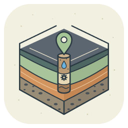
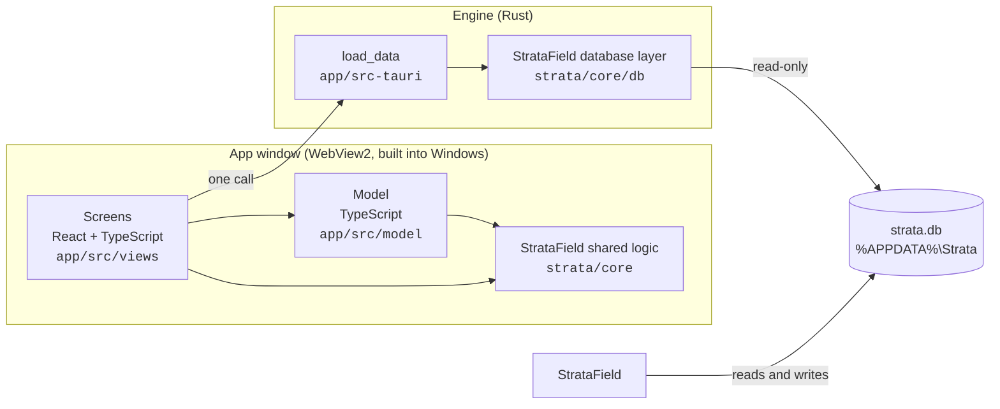

<p align="center">
  
</p>

<h1 align="center">StrataVision</h1>

<p align="center">
  A proposed picture of the ground under Lucknow, worked out from real borewell records.<br>
  What is probably down there, how sure that is, and which borewells say so.
</p>

<p align="center">
  <a href="https://github.com/Mehulsri07/StrataVision/actions/workflows/ci.yml"></a>
  
  
</p>

<p align="center">
  <a href="https://github.com/Mehulsri07/StrataField"><b>StrataField</b></a> ·
  <a href="docs/superpowers/specs/2026-10-13-stratavision-design.md">Design</a> ·
  <a href="LICENSE">MIT licence</a>
</p>

## Overview

[StrataField](https://github.com/Mehulsri07/StrataField) records what was found in each borewell:
the soil layers at each depth, the pipe put in, and the water level over the years. StrataVision
puts all of those records together into a **proposed model of the ground under the whole city**, and
shows it three ways: down a single spot, along any line, and across the city as a map.

It answers the questions a driller asks before starting a new borewell: what layers to expect, where
the water-bearing sand is likely to be, how deep others nearby went, and where they put their
slotted pipe. Where the records are too thin to say, it says "Not enough data" instead of guessing.

The model is worked out again from the records every time they load, so it improves by itself as
borewells are added in StrataField. StrataVision opens the same database **read-only** and never
changes a record.

**Status:** all eight planned phases are built and tested; not yet released. Pilot city: Lucknow.

## Features

| | |
|---|---|
| **Any spot** | Click anywhere on the map for the proposed layers there, in 5 ft steps: drawn strong where likely, pale where a rough guess, blank where there is not enough data. Click a step to see the vote in words ("mostly water-bearing sand, some clay") and the borewells behind it. |
| **Drilling suggestion** | Beside the proposed layers: what was done at the 5 nearest sites (how deep, where the slotted pipe went, how deep the pumps hang), and what the model proposes (expected water level, where to put slotted pipe, how deep to drill). The driller decides. |
| **Section** | Draw a line with bends anywhere on the map, not only between borewells. Real borewells near the line are drawn as solid columns, the ground between and beyond them from the model. Save as picture or PDF. |
| **3D slice** | The same section as a block cut out of the ground, like a slice of cake, that can be turned and tilted. Heights can be stretched. |
| **City map** | Five maps over the whole city: ground at a depth, depth to water-bearing sand, how much water-bearing sand down to a depth, where data is thin, and how fast the water level is rising or falling. |
| **Data quality** | One plain accuracy figure measured on the real records, and a list of borewells that disagree badly with their neighbours, so they can be checked in StrataField. |

---

## Contents

- [How the model works](#how-the-model-works)
- [Architecture](#architecture)
- [Repository layout](#repository-layout)
- [Data access](#data-access)
- [Design principles](#design-principles)
- [Development](#development)
- [Testing and CI](#testing-and-ci)
- [Roadmap](#roadmap)
- [Data sources](#data-sources)

---

## How the model works

The model is a **weighted vote of nearby borewells, depth by depth**. It lives in `app/src/model/`,
is plain TypeScript with no UI code, and is fully unit-tested.

### Four drilling groups

Every recorded soil type is put into one of four groups that matter for drilling:

| Group | Soil types |
|---|---|
| **Clay** | Clay, silty clay, sandy clay, silt |
| **Fine sand** | Fine sand |
| **Water-bearing** | Medium, coarse and yellow sand, gravel, sandy gravel |
| **Hard** | Kankar, clay kankar, sandy kankar, rock, boulder |

A sand layer that the driller ticked as water-bearing counts as water-bearing. Layers marked "Not
recorded", and gaps between layers, never vote.

### The vote

For each 5 ft step down from the surface at the chosen spot:

1. **Common height.** Every borewell's layers are placed by height above sea level (ground height
   minus depth), so on sloping ground a layer is matched by height, not by depth.
2. **Who votes.** Borewells within 5 km that have a recorded layer at that height. The 12 nearest are
   used, with at most 3 from any one spot, so a site with many logs cannot fill the room.
3. **Weight.** `1 / distance²`, then less for a poor record (0.4) or a fair one (0.7), half for a
   borewell whose location came from an address look-up, and shared among borewells within 100 m of
   each other, so a crowded site counts once.
4. **Confidence.**
   - **Likely**: a borewell within 1 km, at least 3 separate sites, and at least 60% agreement.
   - **Rough guess**: a borewell within 3 km and at least 2 separate sites.
   - **Not enough data**: anything else. Nothing is proposed.

Below the deepest borewell that votes, the column ends; it is never extended. Every number above is a
named constant in `app/src/model/constants.ts`.

### Checking itself

The accuracy check (`app/src/model/check.ts`) hides each borewell in turn, together with any other
borewell at the same spot, predicts it from the rest, and compares step by step with what was really
recorded. It reports how often "likely" was right, split by how far away the nearest other borewell
was, and lists the **odd ones out**: borewells that match their surroundings far less often than is
usual at that distance, often a log typed in upside down or a wrong location.

On a made-up city of 500 borewells built like the real records (many at the same spots), a "likely"
step is right at least 7 times in 10, and the figure goes up as borewells are added. The constants are
starting values, to be tuned once on the real records with the Data quality screen.

---

## Architecture

StrataVision is a [Tauri 2](https://tauri.app) application, built on the same stack as StrataField.
It includes StrataField as a **git submodule** and uses its shared code directly.



| Part | Language | Responsibility |
|---|---|---|
| **Screens** (`app/src/views`, `app/src/components`) | React, TypeScript, Tailwind, shadcn/ui, Leaflet | The map, section, 3D slice, city map and Data quality screens, and the drawings. |
| **Model** (`app/src/model`) | TypeScript | The vote, confidence, the accuracy check, the drilling suggestion, sections, slices, city maps and water trends. No UI code; fully unit-tested. |
| **Shared logic** (`strata/core`) | TypeScript | From StrataField: data types, soil types, ground heights, water-level estimates, placing borewells along a line. |
| **Engine** (`app/src-tauri`) | Rust | One command: open `strata.db` read-only and return every borewell not in the Recycle bin, with its layers, pipes and water readings. |

The model lives here rather than in StrataField's `core/`, because StrataField does not use it.
Moving to a newer StrataField is a pull request that changes the submodule pin.

### Speed

Records are prepared once per load (layers converted to height and group). One column is then a few
thousand operations; a section is about 200 columns, and a city map about 10,000 squares at one
depth. The accuracy check takes about 0.1 s on 500 borewells.

---

## Repository layout

```text
StrataVision/
├── app/                        The StrataVision desktop app
│   ├── src/
│   │   ├── views/              One file per screen: MapView, SectionView, CityView, QualityView
│   │   ├── components/         Column, section and 3D slice drawings, the map, shadcn/ui parts
│   │   ├── model/              The model and its tests (*.test.ts)
│   │   │   ├── constants.ts    Every number the model uses
│   │   │   ├── groups.ts       Soil types to the four drilling groups
│   │   │   ├── model.ts        The vote: proposed layers at a spot
│   │   │   ├── check.ts        The accuracy check and odd ones out
│   │   │   ├── drilling.ts     The drilling suggestion
│   │   │   ├── section.ts      A section along a line
│   │   │   ├── slice.ts        The 3D slice behind a section
│   │   │   ├── cityMap.ts      The five city maps
│   │   │   ├── waterTrend.ts   How fast the water level is changing
│   │   │   ├── quality.ts      Accuracy in plain words
│   │   │   ├── words.ts        A step's vote in plain words
│   │   │   └── madeUpCity.ts   500 made-up borewells for tests (not used by the app)
│   │   ├── lib/                api.ts (talks to Rust), loading the model, picture and PDF export
│   │   └── text/index.ts       All wording shown to users, in one place
│   └── src-tauri/              The Rust side: data.rs (read-only loading), lib.rs (the command)
├── strata/                     StrataField, as a git submodule pinned to a release tag (v1.0.15)
├── e2e/smoke.mjs               End-to-end test of the real app
├── docs/superpowers/           The design, and a plan for each phase
├── .github/                    CI and Dependabot
└── Cargo.toml, package.json    Rust and npm workspaces
```

**Good places to start reading:** `app/src/App.tsx` (the four screens), `app/src/model/model.ts`
(the vote) and `app/src/model/constants.ts` (its numbers).

---

## Data access

- StrataVision reads `%APPDATA%\Strata\strata.db`, the database StrataField keeps, and honours
  `STRATA_DATA_DIR` in the same way.
- It opens the database **read-only**, never runs upgrades, and never creates the data folder or
  the database. StrataField can be open at the same time.
- Records reload with **Refresh** and whenever the window comes back into focus.
- If there is no database it says "Install StrataField and add borewells first". A database newer
  than it understands asks for StrataVision to be updated; an older one asks for StrataField to be
  opened once to upgrade it. The file is not touched in either case.

## Design principles

These follow StrataField's, and apply to anyone, or any AI assistant, changing the code.

- **Never make a proposal look measured.** Proposed layers are drawn faded and dashed; recorded ones
  solid. Screens say "proposed layers".
- **Say "not enough data" rather than guess.** A step with too few or too distant borewells is left
  blank, and a column is never extended below the deepest borewell behind it.
- **Every proposal can name its borewells**, with their distance and weight.
- **A crowded spot counts once.** Many logs of one site never outvote a single borewell elsewhere.
- **Read-only.** Records are corrected in StrataField, never here.
- **Plain language.** Users are not technical. All wording lives in `app/src/text/index.ts`.
- **Logic lives in `model/` with tests**; the Rust side does one thing.

---

## Development

**Requirements:** Windows 10 or 11, [Node.js 22](https://nodejs.org), [Rust](https://rustup.rs)
(stable, MSVC) and the Visual Studio C++ Build Tools. WebView2 is already part of Windows.

Clone with the StrataField submodule:

```bash
git clone --recurse-submodules https://github.com/Mehulsri07/StrataVision.git
cd StrataVision
npm install
```

| Command | What it does |
|---|---|
| `npm run dev` | Runs the real app with live reload. |
| `npm run build` | Builds the installer. |
| `npm run typecheck` / `npm run lint` / `npm test` | TypeScript checks and the model's unit tests. |
| `npm run smoke` | End-to-end test of the real app (build first: `npm run tauri -w app -- build --debug --no-bundle`). |
| `cargo fmt --all --check`, `cargo clippy --workspace --all-targets -- -D warnings`, `cargo test --workspace` | Rust formatting, lint and tests. |

To try it without real records, make a folder of made-up borewells and point the app at it
(PowerShell):

```powershell
$env:STRATA_SEED_DIR = "$env:TEMP\strata-vision-dev"; cargo test -p stratavision seed_for_manual_runs -- --ignored
$env:STRATA_DATA_DIR = "$env:TEMP\strata-vision-dev"; npm run dev
```

---

## Testing and CI

- **Model tests** (Vitest): on made-up ground with a known answer. A flat layer is found between
  borewells; on sloping ground layers are matched by height; a crowded site does not outvote a lone
  borewell; confidence drops with distance, fewer sites and disagreement; "Not recorded" never votes;
  a deliberately wrong borewell is flagged as an odd one out; the drilling suggestion only proposes
  slotted pipe below the water level and never deeper than nearby borewells went.
- **Made-up city** (`city.test.ts`): 500 borewells built like the real records, checking that
  "likely" is right at least 7 times in 10, that accuracy rises with more borewells, and that a
  column, a section, a city map and the accuracy check are fast enough.
- **Rust tests** (`data.rs`): the database is opened read-only and left untouched, a missing folder is
  not created, the Recycle bin is left out, newer and older databases are refused, and loading works
  while StrataField has the database open.
- **End-to-end test** (`e2e/smoke.mjs`): starts the real app on a missing data folder (explains, leaves
  no trace) and on made-up borewells: clicks a spot, reads Data quality, draws a section flat and as
  a 3D slice, and paints the city map.
- **CI** (`.github/workflows/ci.yml`): typecheck, lint, unit tests and a frontend build on Linux;
  `npm audit` and `cargo audit`; Rust format, lint and tests on Windows; and the end-to-end test on
  Windows. Documentation-only changes skip CI. Dependabot proposes library updates weekly.

## Roadmap

- **Tune the model on the real records** with the Data quality screen, aiming for "likely" right at
  least 7 times in 10.
- **First release**, following StrataField's: signed installer, automatic updates, and a user manual.
- Not planned unless they prove their worth: several sections standing together on the city map, a
  solid 3D block of the whole city, and correcting the model by hand.

## Data sources

- **Borewell records:** StrataField's database, on the same computer.
- **Maps:** © OpenStreetMap contributors (ODbL). Map tiles are loaded online, so the map needs
  internet; everything else works offline.
- **Ground heights:** StrataField's Lucknow elevation grid, from
  [Terrain Tiles on AWS](https://registry.opendata.aws/terrain-tiles/) (SRTM, NASA). Approximate to a
  few metres.
